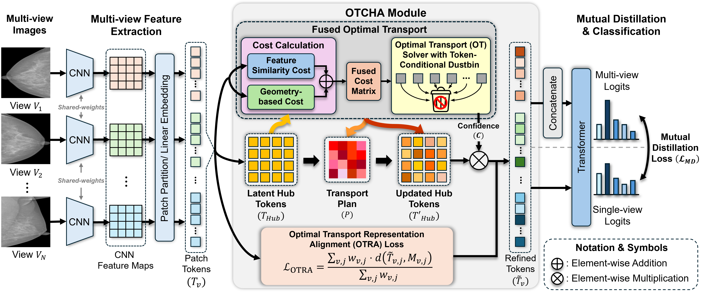

# OTCHA: Optimal Transport-driven Confidence-aware Latent Hub Alignment for Multi-View Medical Image Classification

[](LICENSE)
[](https://papers.miccai.org/miccai-2026/paper/4914_paper.pdf)

Official PyTorch implementation of **OTCHA: Optimal Transport-driven Confidence-aware Latent Hub Alignment**.

**Paper:** [OTCHA: Optimal Transport-driven Confidence-aware Latent Hub Alignment for Multi-View Medical Image Classification](https://papers.miccai.org/miccai-2026/paper/4914_paper.pdf)  
**Authors:** [Jiwoong Yang](https://scholar.google.com/citations?user=rrsgcvcAAAAJ&hl=ko), [Haejun Chung](https://scholar.google.com/citations?user=O-oZnIwAAAAJ&hl=ko), and [Ikbeom Jang](https://scholar.google.com/citations?user=1rBh9xkAAAAJ&hl=ko)  
**Conference:** *MICCAI 2026*

<p align="center">
  
</p>
<p align="center">
  <b>Figure 1.</b> Overview of the proposed OTCHA framework.
</p>

## Abstract

Multi-view imaging, such as mammography and chest radiography, is a standard component of clinical practice. However, medical images are often unregistered and contain view-specific artifacts or irrelevant background cues that can obscure diagnostically relevant findings. Many existing methods directly fuse per-view representations, allowing such irrelevant content to contaminate the fused embedding and reducing robustness under varying view configurations.

We propose **OTCHA**, a confidence-aware latent hub token alignment module based on optimal transport (OT) that refines patch tokens before fusion for multi-view classification. OTCHA introduces a set of learnable latent hub tokens shared across views. For each view, we compute an OT plan between patch tokens and hub tokens that jointly considers feature similarity and geometry, and augment the OT formulation with token-conditional dustbins to enable partial matching and discard irrelevant tokens. The resulting transport plan provides token-wise matching confidence, which gates hub-mediated message passing and weights a novel optimal-transport-based representation alignment loss to stabilize refinement.

Experiments on three multi-view medical image datasets demonstrate consistent improvements over competing baselines across diverse anatomies and view configurations.

## Installation

Use Python 3.9–3.11. A CUDA-capable GPU is recommended for training.

```bash
git clone https://github.com/labhai/OTCHA.git
cd OTCHA
python -m venv .venv
source .venv/bin/activate
python -m pip install --upgrade pip
python -m pip install -r requirements.txt
```

The dependencies are pinned to the versions used to check this release. Install
PyTorch with a CUDA build compatible with your hardware when needed.

## Datasets

Download the datasets from their official sources and prepare the images and
metadata described in [docs/DATASETS.md](docs/DATASETS.md).

| Dataset | Official source | Configuration |
| --- | --- | --- |
| VinDr-Mammo | [PhysioNet](https://physionet.org/content/vindr-mammo/1.0.0/) | 2 breast views or 4 study views; binary BI-RADS classification |
| MURA | [Stanford MURA](https://stanfordmlgroup.github.io/competitions/mura/) | 2 images per study; normal / abnormal |
| CheXpert | [Stanford CheXpert](https://stanfordmlgroup.github.io/competitions/chexpert/) | Frontal and lateral views; 13 observations |

For CheXpert, the paper uses labels from
[VisualCheXbert](https://github.com/stanfordmlgroup/VisualCheXbert). For VinDr-Mammo,
prepare converted images with ROI cropping and background suppression. For MURA,
select studies with at least two images and record two sampled images per study.
Keep patients disjoint across training, validation, and test sets.

Expected local layout:

```text
data/
├── VinDr_Mammo/
│   ├── breast-level_annotations.csv
│   ├── splits.json
│   └── images/<study_id>/<image_id>.png
├── CheXpert/
│   ├── chexpert_label.csv
│   ├── splits.json
│   └── <image paths referenced by the CSV>
└── MURA-v1.1/
    ├── mura_train.csv
    ├── mura_valid.csv
    ├── mura_test.csv
    └── <image paths referenced by the CSV>
```

The files in [examples/](examples/) illustrate metadata formats with fictional
identifiers. Dataset files and the authors' original split assignments are not
included; matching the paper's results requires matching its data preparation
and splits.

## Training

After preparing a dataset, run its training command from the repository root:

```bash
# VinDr-Mammo: breast-level, 2 views
bash run/vindr_otcha.sh

# VinDr-Mammo: study-level, 4 views
bash run/vindr_otcha.sh --num_view 4 --data_mode 4view

# MURA: 2 views
bash run/mura_otcha.sh

# CheXpert: frontal + lateral
bash run/chexpert_otcha.sh
```

Each command starts a new OTCHA training run, selects the best model by validation
AUROC, and evaluates that run's best model on the test set. The ImageNet-pretrained
backbone is downloaded through timm on first use, as in the paper. The authors'
trained OTCHA weights are not distributed or loaded by these commands.

Customize the data location, GPU, seed, or batch size:

```bash
DATA_DIR=/path/to/VinDr_Mammo DEVICE=0 SEED=43 bash run/vindr_otcha.sh
bash run/chexpert_otcha.sh --batch_size 16 --num_workers 4
```

The Python entrypoints and shell scripts use the settings reported in
[Section 3.1 of the paper](https://papers.miccai.org/miccai-2026/paper/4914_paper.pdf):

| Setting | Value |
| --- | --- |
| Backbone | ResNet26 + ViT-S (`vit_small_r26_s32_224`) |
| Input size | 224 × 224 |
| Geometry weight | 0.2 |
| Sinkhorn iterations / epsilon | 20 / 0.2 |
| Mutual distillation weight / OTRA weight | 0.1 / 0.3 |
| Optimizer / learning rate / weight decay | SGD / 1e-3 / 5e-4 |
| Scheduler / minimum learning rate | Cosine annealing / 1e-6 |
| Batch size / maximum epochs | 32 / 100 |

The paper sets the hub count to the number of CNN spatial positions; the supplied
backbone at 224 × 224 yields 49 positions. Geometry bandwidth `1.0` and early
stopping patience `20` are retained implementation defaults; their numerical values
are not specified in the paper.

Each invocation runs one seed;
repeat training with separate `SEED` values for multiple runs. All available
options are listed by the entrypoints:

```bash
python VinDr_otcha.py --help
python MURA_otcha.py --help
python CheXpert_otcha.py --help
```

Training prints metrics in the terminal and saves generated checkpoints under
`result/OTCHA/<dataset>/save_pth/`. Test summaries are saved under
`result/OTCHA/txt/`; VinDr-Mammo and MURA also save CSV results. These outputs are
excluded from Git by `.gitignore`.

## Citation

If you use OTCHA in your research, please cite:

```bibtex
@inproceedings{yang2026otcha,
  title     = {{OTCHA}: Optimal Transport-driven Confidence-aware Latent Hub Alignment for Multi-View Medical Image Classification},
  author    = {Yang, Jiwoong and Chung, Haejun and Jang, Ikbeom},
  booktitle = {Medical Image Computing and Computer Assisted Intervention (MICCAI)},
  year      = {2026},
  url       = {https://papers.miccai.org/miccai-2026/paper/4914_paper.pdf}
}
```

## License

This project is released under the [MIT License](LICENSE).
